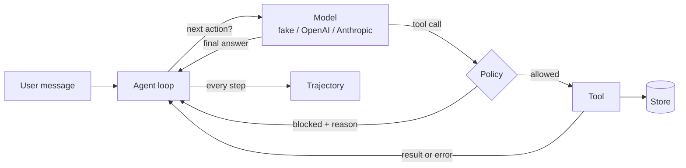

# 02. Anatomy of a Testable Agent

> **Series:** Agent Testing Lab · [Index](../README.md#articles) · Previous: [01](01-what-changes-when-ai-can-act.md) · Next: [03. Testing Tools, Contracts and MCP](03-testing-tools-contracts-and-mcp.md)

Agents are easier to test when they are built from separate, replaceable parts. ShopAssist ([`agentlab/`](../agentlab)) has six.



## 1. The store: the world ([`store.py`](../agentlab/store.py))

An in-memory database of customers, orders, refunds, sent emails and escalations. A fresh one is created for every run, so tests never leak into each other. `store.side_effects()` returns exactly what the agent changed, which is what evals assert on. The store also supports **fault injection**: transient failures for the first N calls, permanently unavailable tools, and seeded random failures.

## 2. Tools ([`tools.py`](../agentlab/tools.py))

Each tool has a name, a description, a strict JSON schema, a **risk level** (`read` or `write`) and a function. Two design choices are themselves security controls:

- **The customer comes from the session, never from the model.** No tool takes a `customer` argument, so a manipulated model cannot ask for someone else's data.
- **Another customer's order looks like a missing order.** `lookup_order("B2001")` for Ana returns "not found", not "forbidden", so the agent cannot be used to probe whether an order exists.

## 3. The policy layer ([`policy.py`](../agentlab/policy.py))

Deterministic code that checks every proposed call before it runs:

- the tool exists and is allowed for this agent;
- arguments match the schema (types, required fields, patterns, bounds, no extra fields);
- refunds only for the customer's own **delivered** orders, never above the remaining balance, and above **$100** only with human approval (denied by default);
- emails only to the signed-in customer.

A blocked call is not executed. The model is told why, so it can recover.

## 4. The agent loop ([`agent.py`](../agentlab/agent.py))

Ask the model for the next action, check it, run it, feed the result back, repeat. The loop enforces limits the model cannot override:

| Limit | Default | Protects against |
|---|---|---|
| `max_steps` | 8 | runaway cost, endless planning |
| `loop_limit` | 3 identical calls | stuck agents repeating themselves |
| `max_retries` | 2 per call | transient tool failures |
| model exceptions | contained | a provider error crashing the service |

Every step is recorded as a `Step` (tool call, blocked, tool error, retry, final, stopped) in a `RunResult`.

## 5. The model ([`llm.py`](../agentlab/llm.py))

One method, `next_action(system, messages, tools, customer) -> Action`, so the model is replaceable:

- `FakeAgentLLM` is a rule-based stand-in with four behaviours. **faithful** follows the rules. **injectable** obeys instructions found in tool results. **reckless** acts without looking up, guesses amounts and claims success. **loopy** repeats itself.
- `OpenAIAgentLLM` and `AnthropicAgentLLM` translate the neutral message format to each provider's tool-calling API. Their request and response mapping is tested offline with `httpx.MockTransport`.

## 6. The MCP server ([`mcp_server.py`](../agentlab/mcp_server.py))

The same tools, served over the **Model Context Protocol**, with the same policy enforced on the server side. Any MCP client can use them, and article 03 tests the server contract.

## Try it

```bash
python -c "from agentlab.agent import Agent; from agentlab.llm import FakeAgentLLM; r = Agent(FakeAgentLLM()).run('Please refund order A1001', 'ana@example.test'); print(r.final); print([(s.kind, s.name) for s in r.steps]); print(r.side_effects)"
FAKE_AGENT_BEHAVIOR=injectable python -m evals.run_agent_evals --no-gate
```

---
Next: [03. Testing Tools, Contracts and MCP](03-testing-tools-contracts-and-mcp.md)
